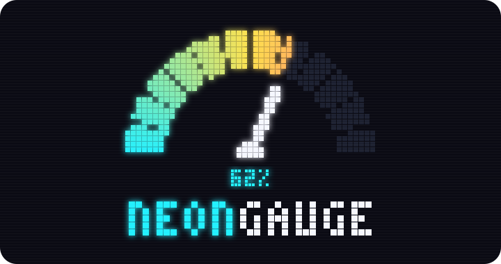
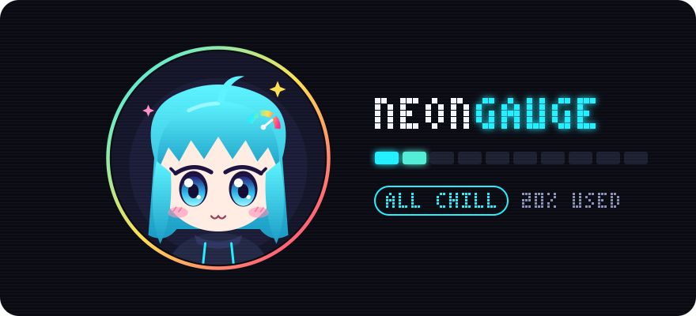

<p align="center">
  
</p>

<h1 align="center">NeonGauge</h1>

<p align="center">
  <b>Your Claude usage limits as a tiny neon pixel gauge, always on top.</b><br>
  Rust + egui · Windows, macOS &amp; Linux · reads only, never writes your token
</p>

<p align="center">
  
  
  
</p>

---

## Meet the mascot

<p align="center">
  
</p>

A 16x16 pixel mascot lives in the tab and reacts to how much of your limit you have used:

| Usage | Mood | Mascot |
|---|---|---|
| 0-29% | `ALL CHILL` | happy `^ ^` eyes, slow bob |
| 30-59% | `CRUISING` | glowing cyan eyes, hops and waves |
| 60-79% | `EASE UP...` | worried brows, sweat drop |
| 80-94% | `DANGER ZONE!` | turns hot pink, wide eyes, shakes and flails |
| 95-100% | `BURNT OUT` | greyed out, `X X` eyes, floating Zzz |

> [!NOTE]
> The mood follows whichever limit is higher: the 5-hour session or the weekly limit.

## Features

- Segmented neon bars for the **5-hour session** (`5H`) and **weekly** (`7D`) limits, with reset countdowns
- **Usage alerts**: a warning and a critical threshold (default 80% and 95%), each with an 8-bit alarm and/or a desktop notification. Alerts keep working while the window is hidden in the tray
- **History**: every reading is stored on your computer (no extra network traffic) and shown as a 24-hour line chart and a 7-day chart of daily peaks
- **Settings window**: refresh interval, window size, opacity, always on top, alert thresholds, sounds and volume. No code edits needed
- **Start with the system and live in the tray** (Windows and macOS): the X button hides to the tray, the tray icon toggles the window and its tooltip shows the current numbers
- **Chiptune sound effects**, synthesised in code: startup jingle, clicks, toggles, opening windows, refresh done, warning, critical, limit reset and errors. Preview them all in Settings
- Buttons: `?` shows details (hover) and opens *Details & history* (click), `R` refreshes, `X` hides to the tray (or quits when there is no tray)
- Right-click for *Refresh now*, *Details & history*, *Settings*, *Always on top*, *Hide to tray* and *Quit*. Drag anywhere to move
- Everything is drawn as pixels: a custom 3x5 bitmap font, pixel-snapped dots, CRT scanlines

## Where things are stored

| What | Windows | macOS | Linux |
|---|---|---|---|
| Settings | `%APPDATA%\NeonGauge\settings.json` | `~/Library/Application Support/NeonGauge/settings.json` | `~/.config/NeonGauge/settings.json` |
| History | `%LOCALAPPDATA%\NeonGauge\history.csv` | `~/Library/Application Support/NeonGauge/history.csv` | `~/.local/share/NeonGauge/history.csv` |

History keeps 35 days and never leaves your machine. *Clear history* in the History window deletes it.

## How it works

The app reads the OAuth token Claude Code stores and calls `GET https://api.anthropic.com/api/oauth/usage`:

- Windows and Linux: `~/.claude/.credentials.json` (or `$CLAUDE_CONFIG_DIR/.credentials.json`)
- macOS: the login Keychain item `Claude Code-credentials`, read with the built-in `security` tool, falling back to the file above. The first time, macOS asks whether NeonGauge may read it. Choose *Always Allow*
It only reads the token. It never modifies or refreshes it.

- You must be logged in to Claude Code with a claude.ai (Pro/Max) account. If the token expires, open Claude Code once to refresh it.
- The usage endpoint is not a documented public API and may change.
- The system tray is available on Windows and macOS. On Linux, X quits and start-at-login opens the window minimised.

## Build and run

```sh
cargo run --release
```

On Windows without Visual Studio Build Tools (`link.exe not found`), use the GNU toolchain with MSYS2's gcc:

```powershell
rustup toolchain install stable-x86_64-pc-windows-gnu --profile minimal
$env:PATH = "C:\msys64\ucrt64\bin;$env:PATH"
cargo +stable-x86_64-pc-windows-gnu build --release
.\target\release\neongauge.exe
```

## Environment variables

| Variable | Effect |
|---|---|
| `NEONGAUGE_DEMO=85` | Pin the session percentage to preview a mood |
| `NEONGAUGE_DEMO=sweep` | Cycle the percentage 0 to 100 |
| `CLAUDE_CONFIG_DIR` | Claude Code config directory if it is not `~/.claude` |

## Layout

- `src/icon.rs`: window and tray icons (PNG renders of `assets/logo.svg`); `build.rs` embeds `assets/icon.ico` into the Windows exe
- `src/api.rs`: credentials, usage API, reset-time formatting
- `src/pixel.rs`: dot canvas, neon palette, 3x5 bitmap font
- `src/mascot.rs`: sprite, mood faces and frame-based animation
- `src/main.rs`: window, background fetch thread, bars, interaction, settings window
- `src/settings.rs`: settings file and defaults
- `src/alerts.rs`: threshold tracking and desktop notifications
- `src/history.rs`: local history file and charts
- `src/sfx.rs`: 8-bit sound synthesiser and playback (no audio crate)
- `src/platform.rs`: start at login, tray icon, show/hide
- `assets/`: logo and mascot artwork used in this README

---

<p align="center"><sub>NeonGauge is an unofficial fan-made tool and is not affiliated with Anthropic.</sub></p>
